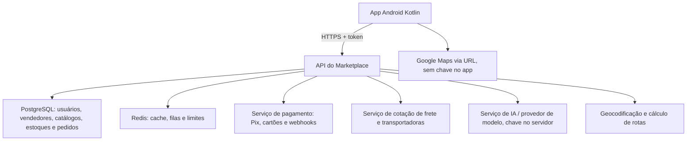

# RCarPremium 3.0 — Marketplace com IA e geolocalização

## Entrega e estágio

Este pacote é o primeiro incremento executável da arquitetura de marketplace. Ele preserva as telas anteriores (estoque, funcionário, vendas, ofertas, CEO, pedidos, carrinho, pagamento e rodapés flutuantes) e adiciona um módulo de multi-lojas.

**Funcional no Android, em modo local:**
- Vitrine de marketplace com buscas por nome, categoria, marca e vendedor.
- Associação dos produtos já cadastrados a uma loja, somente pelo CEO; lojas inativas não mostram anúncios no marketplace.
- Cadastro de lojas parceiras com cidade, UF e coordenadas opcionais, sem criar endereços fictícios.
- Consulta de lojas por distância (linha reta), pedindo apenas permissão de localização aproximada **após tocar no botão**.
- Abertura das lojas cadastradas no Google Maps/navegador por link oficial.
- Recomendações de compra por palavras-chave locais (explicitamente **não são IA**).
- Consulta HTTP **somente leitura** a `/v1/catalog` de um servidor HTTPS, quando configurado.
- Consulta de IA via `/v1/assistant`, com autenticação no servidor e chave da IA somente no backend.
- Identificação de vendedor na página de detalhe do produto.
- Acesso a Marketplace pela página inicial e ao gerenciamento de lojas pelo painel interno do CEO.

**Servidor de referência separado** (`backend/`): API FastAPI com SQLite para desenvolvimento, registro/login de compradores, acesso administrativo protegido por token expirável, cadastro de vendedores e produtos, catálogo público, rascunhos de pedidos sem pagamento, rate limit local por conta para IA e proxy à OpenAI. Testes automatizados em `backend/tests/`.

## Arquitetura prevista para produção



### Responsabilidades

| Camada | Implementado nesta entrega | Necessário para produção |
|---|---|---|
| Android | UI, lojas locais, geolocalização consentida, chat remoto opcional | Navegação orientada a estado, testes instrumentados, telas de erro, acessibilidade |
| Catálogo | API REST de leitura + gestão administrativa de exemplo | Sincronizar o cadastro do CEO com o banco remoto, imagens CDN, busca indexada e paginação |
| Autenticação | Login remoto com PBKDF2 + token HMAC expira em 1 hora | Unificar login local/remoto, refresh tokens/revogação, MFA para CEO, RBAC rigoroso |
| Pedidos | Rascunho de compra na API com cálculo de subtotal pelo servidor | Reservas transacionais de estoque, idempotência, antifraude, mudanças de status, estornos |
| Pagamentos | Fluxo local legado preservado, API NÃO cobra | Gateway homologado, Pix dinâmico, verificação e assinatura de webhook, conciliação |
| Frete | Local legado preservado | Cotação por CEP/origem/destino/peso/dimensões e API logística |
| IA | Proxy backend protegido; recomendações locais sem IA | Credenciais do modelo, orçamento, observabilidade e auditoria, moderação, testes |
| Localização | Aproximada e opt-in; distância por linha reta | Endereços reais verificados, rotas/cotações e boas práticas LGPD |
| Banco | SQLite de demonstração | PostgreSQL, migrações, backup e replicação |

**Atenção:** Android e backend ainda não compartilham os mesmos usuários, produtos e pedidos. Cadastrar produto pelo CEO atual afeta somente o armazenamento local. Para cadastrar um produto na API use os endpoints do administrador remoto. A vitrine online é intencionalmente somente para leitura; compras nela permanecem desabilitadas até integração transacional. A senha local do CEO NÃO serve automaticamente para login da API.

## Abrir o Android Studio

1. Extraia o ZIP e abra `work_rcar` no Android Studio (raiz Gradle).
2. Em **SDK Manager**, instale Android SDK e componentes compatíveis com `compileSdk` definido no projeto. Em caso de SDK ausente, ajuste a configuração do IDE.
3. Aguarde sincronização Gradle; clique **Build > Make Project**.
4. Execute o app no emulador e acesse **MARKETPLACE RCARPREMIUM** na tela principal.
5. Com login de CEO existente, vá ao **Painel Interno > Lojas parceiras / servidor IA**. Cadastre lojas e associe produtos já existentes. Informe latitude/longitude apenas quando tiver coordenadas reais.
6. Em **Perto de mim**, conceda localização aproximada apenas quando desejar. Pode negar e continuar comprando normalmente.

O `local.properties` é específico de cada computador e foi removido do pacote intencionalmente. O Android Studio deve gerar o seu próprio.

## Executar o backend local (Windows PowerShell)

```powershell
cd work_rcar/backend
py -m venv .venv
.\.venv\Scripts\Activate.ps1
pip install -r requirements.txt
$env:RCAR_AUTH_SECRET = "substitua-por-um-segredo-forte-aleatorio-de-32-caracteres-ou-mais"
$env:RCAR_DB_PATH = ".\\rcar-dev.sqlite3"
python create_admin.py
uvicorn app:APP --host 127.0.0.1 --port 8000 --reload
```

Swagger local: `http://127.0.0.1:8000/docs`. No Android, a configuração exige uma **URL pública HTTPS real** (com certificado). **Não publique** o servidor de exemplo diretamente, sem revisar deploy, rate limits, TLS e infraestrutura. A conta criada em `create_admin.py` é exclusiva do backend.

Para ativar respostas de IA no servidor, configure, **somente no ambiente do servidor**:

```powershell
$env:OPENAI_API_KEY = "sua-chave-secreta"
$env:RCAR_OPENAI_MODEL = "um-modelo-compativel-com-a-responses-api"
```

Reinicie o servidor. No app, faça login com a conta do backend na tela **Assistente RCar > Conectar à IA do servidor**. A senha é enviada por HTTPS, não é salva localmente; o token fica somente na memória do processo. Para criar uma conta de comprador no servidor, use `POST /v1/auth/register` no `/docs`.

## Endpoints implementados

- `GET /health`
- `POST /v1/auth/register` (comprador)
- `POST /v1/auth/login`
- `GET /v1/vendors`
- `POST /v1/vendors` (administrador remoto)
- `GET /v1/catalog?q=&vendor_id=&limit=50`
- `POST /v1/products` (administrador remoto)
- `POST /v1/orders/draft` (autenticado, **não cobra e não reserva estoque**)
- `GET /v1/orders/me` (rascunhos da própria conta)
- `POST /v1/assistant` (autenticado, limitado por conta; depende de provedor configurado)

Exemplo para criar loja com admin do backend usando `/docs`:

1. Autentique em `POST /v1/auth/login` e copie o `access_token`.
2. Clique **Authorize**, informe `Bearer <token>` (o formato depende do Swagger/manual).
3. Execute `POST /v1/vendors` e guarde o `id`.
4. Execute `POST /v1/products` usando `vendor_id` e `price_cents` em centavos inteiros.
5. Verifique `GET /v1/catalog` e, no Android, **Atualizar catálogo do servidor**.

## Segurança e pendências antes do lançamento público

- Eliminar usuários/senhas de demonstração do código legado e migrar definitivamente as contas locais para o backend; nunca usar SharedPreferences como fonte de verdade de permissões comerciais.
- Adicionar autorização do lado do servidor para cada papel e cada vendedor, com auditoria, mudanças de credenciais e recuperação segura de conta.
- Revisar LGPD (finalidade, consentimento, exclusão, retenção e acessos), política de privacidade e autenticação robusta; nunca enviar localização para IA desnecessariamente.
- Adicionar gateway de pagamento Pix/cartão com webhook autenticado, antifraude, conciliação e regras de cancelamento.
- Adicionar cotação real de frete e cálculo de prazo; distância em linha reta não é valor de frete.
- Usar PostgreSQL, transações e migrações de banco, logs, backups, monitoramento, CI/CD e testes Android com emulador.
- Implementar sincronização real de dados entre app e servidor, incluindo ofertas, estoque, pedidos e múltiplos vendedores.
- Remover o `--reload` e o SQLite quando migrar para ambiente de produção.

## Verificação desta entrega

- XMLs Android: analisados estruturalmente com `lxml`.
- Backend: `pytest -q` **2 testes passando**.
- Compilação Android: **não verificada**. O Gradle Wrapper tentou baixar distribuição externa e o ambiente estava sem acesso DNS (`services.gradle.org`). É necessário compilar no Android Studio.
